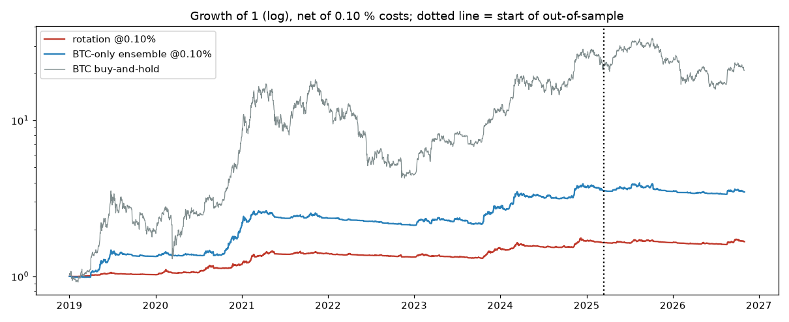

# Crypto trend rotation — results

Generated by `uv run crypto-trend`; rules in [PREREG.md](../PREREG.md).

Panel: 700 USDT pairs, 2017-08-17 → 2026-10-31; 124 coins ever in the universe; average members per day 18.4.

## replication (2019-01-01 → 2025-03-14)

| strategy (net) | days | CAGR | vol | sharpe | maxDD | alpha_ann | alpha_t | beta |
|---|---|---|---|---|---|---|---|---|
| rotation @0.05% | 2265.000 | 0.085 | 0.072 | 1.175 | -0.097 | 0.039 | 1.645 | 0.063 |
| rotation @0.10% | 2265.000 | 0.084 | 0.072 | 1.150 | -0.101 | 0.037 | 1.570 | 0.063 |
| rotation @0.25% | 2265.000 | 0.078 | 0.072 | 1.076 | -0.113 | 0.032 | 1.344 | 0.063 |
| BTC-only ensemble @0.10% | 2265.000 | 0.226 | 0.156 | 1.383 | -0.192 | 0.090 | 2.103 | 0.175 |
| BTC buy-and-hold | 2265.000 | 0.654 | 0.653 | 1.103 | -0.766 | -0.000 | -3.668 | 1.000 |

Rotation @0.10 %: mean gross exposure 0.07, turnover 3.6× a year, annual cost drag 0.36%.

## oos (2025-03-15 → 2026-10-31)

| strategy (net) | days | CAGR | vol | sharpe | maxDD | alpha_ann | alpha_t | beta |
|---|---|---|---|---|---|---|---|---|
| rotation @0.05% | 596.000 | 0.012 | 0.057 | 0.233 | -0.068 | 0.010 | 0.278 | 0.073 |
| rotation @0.10% | 596.000 | 0.009 | 0.057 | 0.187 | -0.070 | 0.008 | 0.210 | 0.073 |
| rotation @0.25% | 596.000 | 0.001 | 0.057 | 0.052 | -0.078 | 0.000 | 0.007 | 0.073 |
| BTC-only ensemble @0.10% | 596.000 | -0.013 | 0.106 | -0.067 | -0.155 | -0.013 | -0.199 | 0.158 |
| BTC buy-and-hold | 596.000 | -0.047 | 0.415 | 0.090 | -0.530 | -0.000 | -0.121 | 1.000 |

Rotation @0.10 %: mean gross exposure 0.09, turnover 5.1× a year, annual cost drag 0.51%.

## Rotation @0.10 % by year

| year | CAGR | sharpe | maxDD | alpha_ann | beta |
|---|---|---|---|---|---|
| 2019 | 0.026 | 0.910 | -0.032 | -0.001 | 0.030 |
| 2020 | 0.163 | 1.752 | -0.052 | 0.055 | 0.059 |
| 2021 | 0.173 | 1.761 | -0.048 | 0.104 | 0.075 |
| 2022 | -0.051 | -1.497 | -0.053 | -0.025 | 0.033 |
| 2023 | 0.135 | 1.733 | -0.060 | 0.011 | 0.115 |
| 2024 | 0.117 | 1.312 | -0.068 | 0.012 | 0.110 |
| 2025 | -0.023 | -0.408 | -0.044 | -0.024 | 0.075 |
| 2026 | 0.018 | 0.338 | -0.036 | 0.023 | 0.067 |

## Pre-registered verdict

**PASS**

```
replication Sharpe 1.150 (needs >= 1.0): True
OOS Sharpe 0.187 (> 0) and alpha 0.008 (t 0.21, > 0): True
```


