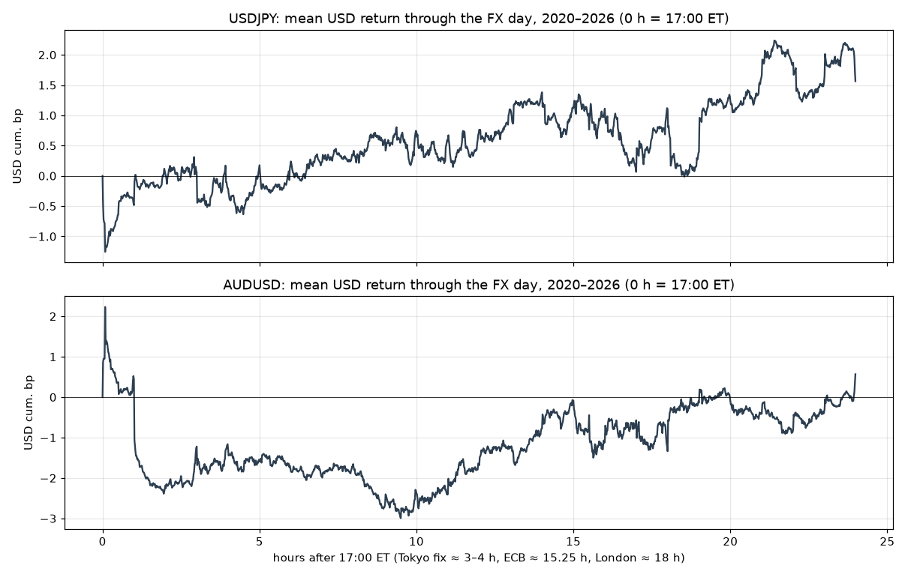

# FX fix flows — results

Generated by `uv run fx-fix-flows`; rules in [PREREG.md](../PREREG.md). Daily returns in bp of price; positive = the rule made money.

## Gross leg returns in the paper's direction (no cost)

Positive mean = the leg moved the way the paper says.

| pair leg | N | mean_bp | t | W |
|---|---|---|---|---|
| USDJPY preT | 1373.0 | 0.745 | 1.422 | 0.543 |
| USDJPY postT | 1752.0 | 0.426 | 0.736 | 0.506 |
| USDJPY preE | 1694.0 | 1.135 | 1.534 | 0.543 |
| USDJPY postL | 1648.0 | -0.171 | -0.324 | 0.498 |
| USDJPY br_local | 1695.0 | -0.031 | -0.044 | 0.522 |
| USDJPY br_us | 1671.0 | -0.948 | -1.016 | 0.466 |
| AUDUSD preT | 1377.0 | -0.395 | -0.662 | 0.471 |
| AUDUSD postT | 1750.0 | 1.942 | 2.772 | 0.526 |
| AUDUSD preE | 1695.0 | 0.688 | 0.815 | 0.505 |
| AUDUSD postL | 1650.0 | -2.342 | -3.165 | 0.454 |
| AUDUSD br_local | 1694.0 | -1.723 | -2.236 | 0.472 |
| AUDUSD br_us | 1670.0 | 0.248 | 0.218 | 0.510 |

## Strategies net of 0.5 pip per leg

| rule | N | mean_bp | t | W | PF | ann_bp | sharpe |
|---|---|---|---|---|---|---|---|
| T-USDJPY | 1373.0 | 0.378 | 0.451 | 0.516 | 1.037 | 95.3 | 0.193 |
| E-USDJPY | 1643.0 | 0.179 | 0.194 | 0.514 | 1.014 | 45.0 | 0.076 |
| W-USDJPY | 1310.0 | 0.300 | 0.221 | 0.517 | 1.018 | 75.6 | 0.097 |
| BR-USDJPY | 1649.0 | -1.890 | -1.612 | 0.461 | 0.889 | -476.4 | -0.630 |
| T-AUDUSD | 1375.0 | -0.211 | -0.199 | 0.468 | 0.984 | -53.1 | -0.085 |
| E-AUDUSD | 1639.0 | -3.066 | -2.668 | 0.466 | 0.833 | -772.7 | -1.046 |
| W-AUDUSD | 1304.0 | -2.698 | -1.677 | 0.473 | 0.883 | -680.0 | -0.737 |
| BR-AUDUSD | 1644.0 | -2.699 | -1.921 | 0.473 | 0.877 | -680.1 | -0.752 |

### Net mean bp/day by cost per leg

| rule | 0.0 pip | 0.3 pip | 0.5 pip | 1.0 pip |
|---|---|---|---|---|
| T-USDJPY | 1.140 | 0.683 | 0.378 | -0.383 |
| E-USDJPY | 0.940 | 0.483 | 0.179 | -0.583 |
| W-USDJPY | 1.825 | 0.910 | 0.300 | -1.225 |
| BR-USDJPY | -1.129 | -1.586 | -1.890 | -2.652 |
| T-AUDUSD | 1.251 | 0.374 | -0.211 | -1.672 |
| E-AUDUSD | -1.606 | -2.482 | -3.066 | -4.526 |
| W-AUDUSD | 0.221 | -1.531 | -2.698 | -5.618 |
| BR-AUDUSD | -1.238 | -2.115 | -2.699 | -4.159 |

### T-USDJPY by year (net 0.5 pip)

| year | N | mean_bp | t | W |
|---|---|---|---|---|
| 2020 | 211.0 | -0.040 | -0.018 | 0.507 |
| 2021 | 210.0 | 2.394 | 2.132 | 0.567 |
| 2022 | 211.0 | 5.521 | 2.073 | 0.536 |
| 2023 | 167.0 | -7.214 | -2.809 | 0.443 |
| 2024 | 208.0 | 1.392 | 0.611 | 0.505 |
| 2025 | 210.0 | -2.184 | -0.945 | 0.490 |
| 2026 | 156.0 | 1.500 | 0.881 | 0.558 |

### BR-USDJPY by year (net 0.5 pip)

| year | N | mean_bp | t | W |
|---|---|---|---|---|
| 2020 | 258.0 | -6.312 | -2.866 | 0.415 |
| 2021 | 258.0 | 1.351 | 0.802 | 0.527 |
| 2022 | 260.0 | -2.071 | -0.576 | 0.454 |
| 2023 | 167.0 | 0.576 | 0.133 | 0.443 |
| 2024 | 255.0 | -0.790 | -0.220 | 0.475 |
| 2025 | 259.0 | -3.812 | -1.167 | 0.471 |
| 2026 | 192.0 | -1.075 | -0.393 | 0.432 |

### T-AUDUSD by year (net 0.5 pip)

| year | N | mean_bp | t | W |
|---|---|---|---|---|
| 2020 | 211.0 | 6.320 | 1.436 | 0.483 |
| 2021 | 210.0 | -1.247 | -0.644 | 0.510 |
| 2022 | 211.0 | 2.036 | 0.745 | 0.521 |
| 2023 | 171.0 | -4.245 | -1.509 | 0.421 |
| 2024 | 209.0 | -0.827 | -0.387 | 0.488 |
| 2025 | 209.0 | -1.651 | -0.759 | 0.421 |
| 2026 | 154.0 | -3.552 | -1.567 | 0.409 |

### BR-AUDUSD by year (net 0.5 pip)

| year | N | mean_bp | t | W |
|---|---|---|---|---|
| 2020 | 258.0 | -5.212 | -1.350 | 0.446 |
| 2021 | 258.0 | -0.809 | -0.274 | 0.477 |
| 2022 | 259.0 | -4.297 | -0.924 | 0.486 |
| 2023 | 163.0 | -5.426 | -1.050 | 0.466 |
| 2024 | 256.0 | -3.200 | -1.119 | 0.465 |
| 2025 | 259.0 | -0.513 | -0.154 | 0.490 |
| 2026 | 191.0 | 0.346 | 0.114 | 0.482 |

## Pre-registered verdict

**KILL**

```
primary p: T-USDJPY=0.3259, T-AUDUSD=0.5787
primary Holm reject: {'T-USDJPY': False, 'T-AUDUSD': False}
T net > 0 at 1.0 pip: {'T-USDJPY': np.False_, 'T-AUDUSD': np.False_}
secondary p: E-USDJPY=0.4231, E-AUDUSD=0.9962, W-USDJPY=0.4126, W-AUDUSD=0.9532, BR-USDJPY=0.9465, BR-AUDUSD=0.9726
secondary Holm reject: {'W-USDJPY': False, 'E-USDJPY': False, 'BR-USDJPY': False, 'W-AUDUSD': False, 'BR-AUDUSD': False, 'E-AUDUSD': False}
```


