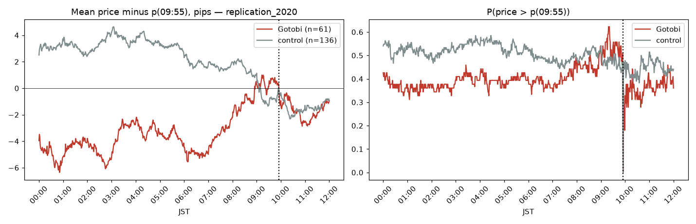
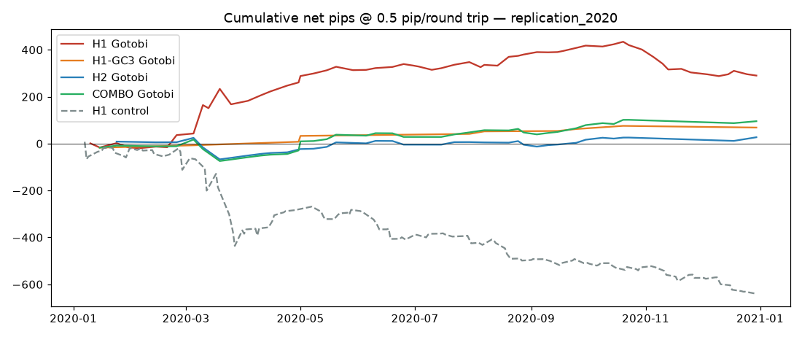
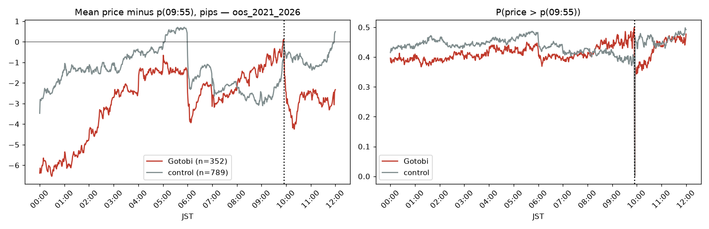
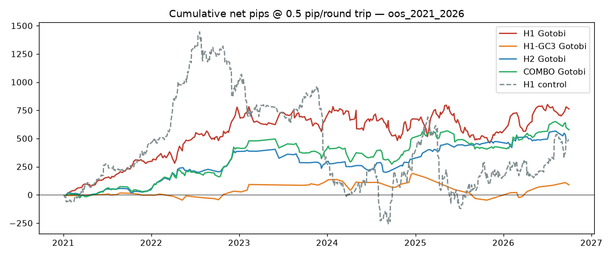

# Gotobi backtest results

Generated by `uv run gotobi`; rules and gates in [PREREG.md](../PREREG.md).
Data: 2,457,608 M1 bars, 2020-01-02 07:00:00+09:00 → 2026-10-01 12:58:00+09:00 (JST).

## replication_2020

61 Gotobi days, 136 control days.

| net @ 0.5 pip | N | mean | t | PF | PR | W | total |
|---|---|---|---|---|---|---|---|
| H1 gotobi | 61.0 | 4.756 | 1.455 | 1.808 | 1.173 | 0.607 | 290.1 |
| H1 control | 135.0 | -4.732 | -2.249 | 0.526 | 0.601 | 0.467 | -638.8 |
| H1-GC3 gotobi | 10.0 | 6.840 | 1.817 | 3.792 | 0.948 | 0.800 | 68.4 |
| H1-GC3 control | 26.0 | -0.550 | -0.136 | 0.924 | 1.260 | 0.423 | -14.3 |
| H2 gotobi | 36.0 | 0.753 | 0.313 | 1.171 | 0.662 | 0.639 | 27.1 |
| H2 control | 51.0 | 2.661 | 1.125 | 1.602 | 1.121 | 0.588 | 135.7 |
| COMBO gotobi | 38.0 | 2.513 | 0.949 | 1.547 | 0.805 | 0.658 | 95.5 |
| COMBO control | 65.0 | 1.868 | 0.721 | 1.307 | 1.347 | 0.492 | 121.4 |
| H1_GC1 gotobi | 10.0 | -3.240 | -0.570 | 0.661 | 0.661 | 0.500 | -32.4 |
| H1_GC1 control | 23.0 | -12.2 | -1.550 | 0.370 | 0.404 | 0.478 | -281.4 |
| H1_GC2 gotobi | 8.000 | 4.900 | 1.182 | 2.950 | 0.983 | 0.750 | 39.2 |
| H1_GC2 control | 25.0 | 1.656 | 0.317 | 1.237 | 1.855 | 0.400 | 41.4 |
| H1_GC4 gotobi | 13.0 | 2.038 | 0.417 | 1.387 | 0.616 | 0.692 | 26.5 |
| H1_GC4 control | 26.0 | -7.523 | -1.208 | 0.464 | 0.743 | 0.385 | -195.6 |
| H1_GC5 gotobi | 12.0 | 10.8 | 1.719 | 6.369 | 2.123 | 0.750 | 129.4 |
| H1_GC5 control | 15.0 | -9.680 | -1.266 | 0.311 | 0.272 | 0.533 | -145.2 |

| Gotobi net mean pips by cost | 0.3 | 0.5 | 1.0 | 2.0 |
|---|---|---|---|---|
| COMBO | 2.755 | 2.513 | 1.908 | 0.697 |
| H1 | 4.956 | 4.756 | 4.256 | 3.256 |
| H1-GC3 | 7.040 | 6.840 | 6.340 | 5.340 |
| H2 | 0.953 | 0.753 | 0.253 | -0.747 |

09:55→09:56 move, Gotobi − control: -0.252 pips (t = -0.75).

| H1 Gotobi by year | N | mean | t | PF | W | total |
|---|---|---|---|---|---|---|
| 2020 | 61.0 | 4.756 | 1.455 | 1.808 | 0.607 | 290.1 |

| H2 Gotobi by year | N | mean | t | PF | W | total |
|---|---|---|---|---|---|---|
| 2020 | 36.0 | 0.753 | 0.313 | 1.171 | 0.639 | 27.1 |

H1 Gotobi net mean, block-bootstrap 95% CI: [-1.07, 13.47] pips.





## oos_2021_2026

353 Gotobi days, 790 control days.

| net @ 0.5 pip | N | mean | t | PF | PR | W | total |
|---|---|---|---|---|---|---|---|
| H1 gotobi | 344.0 | 2.214 | 1.425 | 1.241 | 0.852 | 0.593 | 761.5 |
| H1 control | 753.0 | 0.652 | 0.496 | 1.059 | 0.862 | 0.551 | 490.6 |
| H1-GC3 gotobi | 60.0 | 1.478 | 0.389 | 1.148 | 0.940 | 0.550 | 88.7 |
| H1-GC3 control | 137.0 | 1.786 | 0.501 | 1.140 | 0.837 | 0.577 | 244.7 |
| H2 gotobi | 188.0 | 2.597 | 1.773 | 1.483 | 1.333 | 0.527 | 488.3 |
| H2 control | 373.0 | -1.423 | -1.223 | 0.826 | 0.885 | 0.483 | -530.9 |
| COMBO gotobi | 217.0 | 2.659 | 1.581 | 1.373 | 1.218 | 0.530 | 577.0 |
| COMBO control | 432.0 | -0.662 | -0.431 | 0.935 | 0.962 | 0.493 | -286.2 |
| H1_GC1 gotobi | 63.0 | 5.105 | 0.915 | 1.399 | 1.119 | 0.556 | 321.6 |
| H1_GC1 control | 129.0 | 7.422 | 2.478 | 1.936 | 1.394 | 0.581 | 957.5 |
| H1_GC2 gotobi | 52.0 | 10.4 | 3.562 | 3.758 | 1.670 | 0.692 | 539.4 |
| H1_GC2 control | 126.0 | -0.606 | -0.236 | 0.944 | 0.831 | 0.532 | -76.3 |
| H1_GC4 gotobi | 57.0 | 1.902 | 0.529 | 1.199 | 0.811 | 0.596 | 108.4 |
| H1_GC4 control | 149.0 | -2.677 | -1.303 | 0.745 | 0.716 | 0.510 | -398.8 |
| H1_GC5 gotobi | 56.0 | 0.788 | 0.170 | 1.078 | 0.647 | 0.625 | 44.1 |
| H1_GC5 control | 133.0 | -3.021 | -1.019 | 0.746 | 0.651 | 0.534 | -401.8 |

| Gotobi net mean pips by cost | 0.3 | 0.5 | 1.0 | 2.0 |
|---|---|---|---|---|
| COMBO | 2.888 | 2.659 | 2.088 | 0.945 |
| H1 | 2.414 | 2.214 | 1.714 | 0.714 |
| H1-GC3 | 1.678 | 1.478 | 0.978 | -0.022 |
| H2 | 2.797 | 2.597 | 2.097 | 1.097 |

09:55→09:56 move, Gotobi − control: -1.202 pips (t = -4.91).

| H1 Gotobi by year | N | mean | t | PF | W | total |
|---|---|---|---|---|---|---|
| 2021 | 60.0 | 4.960 | 3.747 | 3.548 | 0.733 | 297.6 |
| 2022 | 63.0 | 6.878 | 2.161 | 1.974 | 0.619 | 433.3 |
| 2023 | 52.0 | -0.688 | -0.167 | 0.935 | 0.558 | -35.8 |
| 2024 | 61.0 | -0.369 | -0.071 | 0.974 | 0.574 | -22.5 |
| 2025 | 62.0 | -1.800 | -0.444 | 0.867 | 0.435 | -111.6 |
| 2026 | 46.0 | 4.359 | 1.182 | 1.587 | 0.652 | 200.5 |

| H2 Gotobi by year | N | mean | t | PF | W | total |
|---|---|---|---|---|---|---|
| 2021 | 41.0 | 1.078 | 0.784 | 1.406 | 0.512 | 44.2 |
| 2022 | 39.0 | 8.731 | 2.534 | 3.388 | 0.615 | 340.5 |
| 2023 | 22.0 | -4.214 | -0.794 | 0.591 | 0.409 | -92.7 |
| 2024 | 31.0 | 0.755 | 0.192 | 1.113 | 0.516 | 23.4 |
| 2025 | 27.0 | 5.800 | 1.808 | 2.517 | 0.593 | 156.6 |
| 2026 | 28.0 | 0.582 | 0.122 | 1.073 | 0.464 | 16.3 |

H1 Gotobi net mean, block-bootstrap 95% CI: [-0.62, 4.78] pips.

### Pre-registered verdict

**KILL**

```
T1 H1 net: {'N': 344, 'mean': 2.2137, 'sd': 28.8022, 't': 1.4255, 'p_one_sided': 0.077, 'PF': 1.2415, 'PR': 0.852, 'W': 0.593, 'total': 761.5}
T1 H1 gotobi-control (gross): {'diff': 1.5621, 't': 0.7681, 'p_one_sided': 0.2212, 'Na': 344, 'Nb': 753}
H1 net @1.0: {'N': 344, 'mean': 1.7137, 'sd': 28.8022, 't': 1.1035, 'p_one_sided': 0.1349, 'PF': 1.1829, 'PR': 0.8315, 'W': 0.5872, 'total': 589.5}
T1 pass: False
secondary p: {'H1-GC3 net': 0.3485, 'H2 net': 0.0381, 'COMBO net': 0.057, 'H2 gotobi-control': 0.0158}
secondary Holm reject: {'H2 gotobi-control': False, 'H2 net': False, 'COMBO net': False, 'H1-GC3 net': False}
```




