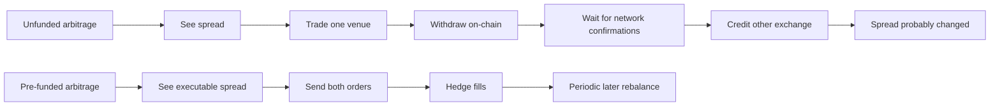
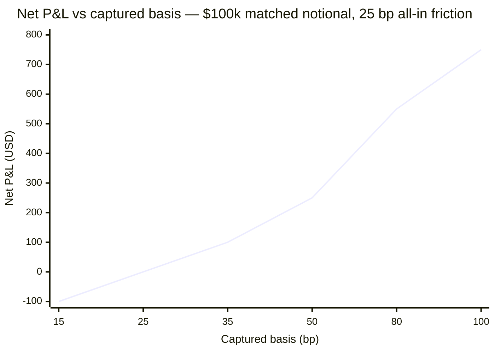
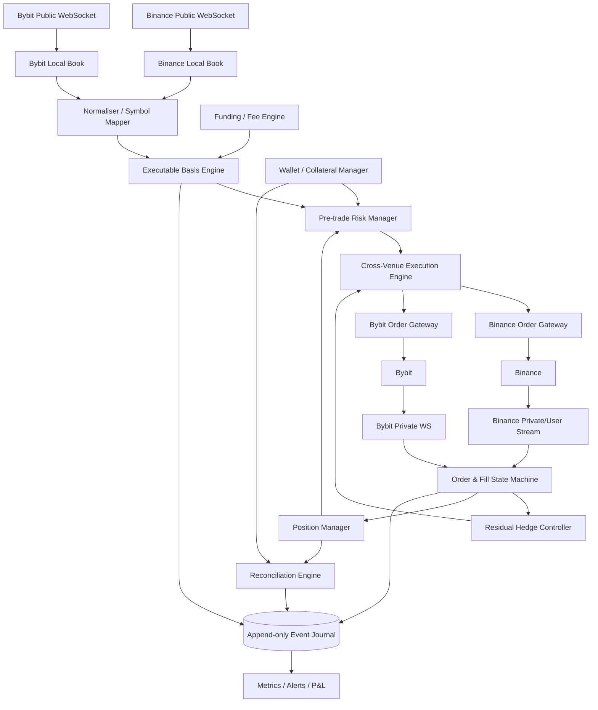

# Binance–Bybit Pre-Funded Cross-Platform Arbitrage: Viability, Economics and C++ Implementation

## Executive summary

**Conclusion:** a pre-funded Binance–Bybit arbitrage strategy is technically viable, but the economically preferable implementation is usually **USDT-margined perpetual-futures versus USDT-margined perpetual-futures**, rather than spot-versus-spot, provided that derivatives trading is legally and operationally available to the account holder in both jurisdictions. The reason is not leverage: it is **lower transaction-fee friction, symmetric ability to go long or short, and much less capital fragmentation across individual coins**. Binance's current regular-user USDⓈ-M futures schedule is 0.020% maker / 0.050% taker, with a 10% BNB fee-payment discount available on eligible USDⓈ-M futures; Bybit's current non-VIP perpetual/futures schedule is 0.020% maker / 0.055% taker. In contrast, regular crypto spot is 0.100% maker/taker on both exchanges, although eligible Binance spot fees fall to 0.075% when paid with BNB. citeturn17search0turn17search4turn18search4turn19search0

For a **complete arbitrage cycle**—opening a long on the cheap venue and a short on the rich venue, then closing both after the inter-exchange basis converges—a regular-user futures implementation using taker execution on every fill incurs approximately **21 basis points (0.21%) of trading fees before slippage and funding**:

\[
2(0.050\%_{\text{Binance}}+0.055\%_{\text{Bybit}})=0.210\%.
\]

With the Binance 10% BNB futures discount, that falls to roughly 20 bp. A comparable spot round trip costs about 40 bp at standard rates or about **35 bp** with Binance's 25% spot BNB discount, again before slippage. citeturn17search0turn18search4turn19search0

That makes the economic boundary fairly stark. At regular futures fees, a strategy whose **actually captured basis** is 35 bp and whose aggregate entry-and-exit slippage is 4 bp produces only about **10 bp net**. On $25,000 matched notional that is $25; on $125,000 it is $125. Small modelling errors, stale-book trades or one failed leg can erase dozens of such wins. Consequently, the strategy is viable **only if the measured distribution of executable—not quoted—cross-venue dislocations comfortably clears a roughly 25–35 bp all-in threshold at the intended position size**, or if the system earns lower maker/VIP fees. This threshold is derived from the exchanges' published fees plus explicit modelling assumptions below, rather than from a claim that such spreads occur with any particular frequency. citeturn17search0turn18search4

The main advantage of pre-funding is that **blockchain settlement leaves the critical path**. Binance states that blockchain confirmation time depends on the network and current traffic; its withdrawal fees are dynamic. Bybit similarly charges chain-dependent withdrawal fees and notes that withdrawals can be affected by wallet/network status, while on-chain deposits themselves carry no Bybit deposit fee. Pre-funding therefore transforms an on-chain transfer arbitrage into an execution problem measured in milliseconds rather than a settlement problem measured in blocks or minutes. Periodic inventory/collateral rebalancing still remains necessary. citeturn23search0turn23search1turn23search3turn23search4

The most serious risk is **not outright BTC/altcoin direction after both legs fill; it is cross-venue basis and execution risk**. A portfolio can be nearly delta-neutral globally yet have a losing leg liquidated on one exchange because Binance and Bybit do not recognise the hedge held at the other venue. Bybit bases important margin calculations on mark price and applies risk tiers; Binance likewise uses a maintenance-margin system. This is why high leverage is counterproductive for this strategy. A practical starting policy is **isolated margin at 2× selected leverage, substantial idle collateral at each exchange, hard per-symbol exposure limits and automatic imbalance hedging**. citeturn24search0turn24search2turn24search11turn24search14

For example, with **$50,000 total capital**, a prudent initial deployment is roughly $25,000 at each venue and around **$20,000–$25,000 matched notional per active arbitrage pair**, not $50,000+ per leg merely because the exchanges allow leverage. With **$250,000**, an analogous initial range is approximately $100,000–$125,000 per leg, with excess collateral retained for basis widening, failed-leg recovery and simultaneous opportunities. These are risk-policy examples, not exchange minimums.

The earlier discussion supplied with this request explored a much smaller, spot-oriented implementation and contemplated Python and volatile altcoins. That transcript remains useful background, but its fee and infrastructure assumptions should not be treated as the current production specification; the present report supersedes those assumptions with current exchange documentation and a futures-first design. fileciteturn0file0

**Overall assessment:**

| Configuration | Economic viability | Principal weakness |
|---|---:|---|
| Pre-funded spot, taker/taker | **Low–moderate** | ~35–40 bp round-trip fee floor plus fragmented token inventory |
| Pre-funded futures, taker/taker | **Moderate** | ~20–21 bp round-trip fee floor plus slippage/funding |
| Futures, maker on one leg / taker hedge | **Moderate–high if execution quality is proven** | Maker adverse selection and fill uncertainty |
| Futures, maker/maker | **Potentially high fee efficiency, operationally dangerous** | Large probability of one-sided or no fills |
| Transfer-after-each-trade spot arb | **Poor for short-lived dislocations** | Blockchain/network latency remains in critical path |
| Leveraged futures at high leverage | **Not recommended** | Cross-venue hedge is not recognised for liquidation purposes |

The recommended production progression is therefore **pre-funded USDT perpetuals → low leverage → taker/taker IOC execution → measured live profitability → selectively introduce maker/taker execution only after fill-probability and adverse-selection data justify it**.

## Economics, venue choice and capital model

### Why perpetual futures are preferable to spot

Spot-to-spot arbitrage is deceptively capital-intensive. Suppose an asset is temporarily cheaper on Binance and richer on Bybit. Buying Binance spot needs USDT on Binance, while selling spot on Bybit requires the actual token to have been pre-positioned on Bybit. To exploit the opposite direction later, the inverse inventories are needed as well. Across ten or twenty candidate symbols this fragments capital into many token inventories, and those inventories themselves create market exposure unless continuously hedged.

Spot margin can eliminate some of this inventory problem by borrowing the token to sell, but that reintroduces borrowing cost, collateral requirements and liquidation risk. Bybit, for example, describes spot-margin trading as borrowed-fund trading secured by collateral and subject to liquidation risk. citeturn24search13

USDT perpetuals solve the inventory problem more cleanly. Both legs can be opened from stablecoin collateral:

\[
\text{cheap venue}: +N \text{ long perpetual}
\]

\[
\text{rich venue}: -N \text{ short perpetual}.
\]

Bybit's USDT contracts use USDT as margin and settle P&L in USDT; Binance USDⓈ-M contracts use a maintenance-margin framework for leveraged futures positions. citeturn24search10turn24search14

The intended profit is then **convergence of the Binance–Bybit perpetual basis**, not the outright movement of the underlying.

Let

\[
g_0=\frac{P^{rich}_{entry}-P^{cheap}_{entry}}{P_{mid}}
\]

be the executable entry gap and \(g_1\) the gap when both positions are closed. For matched notionals \(N\), the first-order gross arbitrage P&L is

\[
\Pi_{gross}\approx N(g_0-g_1).
\]

After costs,

\[
\boxed{
\Pi_{net}\approx N[
(g_0-g_1)
-F_{trade}
-S_{execution}
-F_{funding}
]
}
\]

where \(F_{trade}\) is all four entry/exit trading fees, \(S_{execution}\) includes depth, slippage and legging losses, and \(F_{funding}\) is the net funding cost over the holding period.

This formulation is critical: **the displayed cross-exchange spread is not the expected return**. The relevant variable is the part of that spread that can actually be entered, subsequently exited, and retained after all four executions.

### Current fee comparison

The following figures use ordinary crypto pairs rather than promotional, pre-market or special-zone contracts. Bybit explicitly has separate, higher rates for some Pre-Market and Innovation Zone perpetuals, so those instruments should not be treated as having ordinary perpetual fees. citeturn18search6

| Product | Binance regular user | Bybit VIP 0 | Full four-fill taker cycle |
|---|---:|---:|---:|
| Spot | Maker 0.100%; taker 0.100% citeturn19search0 | Maker 0.100%; taker 0.100% citeturn18search4 | **40 bp** |
| Spot with Binance BNB discount | 0.075% / 0.075% on eligible spot trades citeturn19search0 | 0.100% / 0.100% | **35 bp** |
| USDT perpetual / USDⓈ-M futures | Maker 0.020%; taker 0.050% citeturn17search0turn17search4 | Maker 0.020%; taker 0.055% citeturn18search4 | **21 bp** |
| Futures with Binance BNB discount | Eligible USDⓈ-M fees discounted 10%; regular example 0.018% / 0.045% citeturn17search0turn17search4 | 0.020% / 0.055% | **20 bp** |
| Futures, one maker + one taker on each entry/exit | Depends on which venue makes | Depends on which venue takes | roughly **14–15 bp** before promotions/VIP |
| Futures, maker/maker | 0.020% | 0.020% | **8 bp**, but materially greater fill risk |

Bybit's VIP schedule drops perpetual taker fees from 0.0550% at VIP 0 to 0.0400% at VIP 1, 0.0375% at VIP 2 and 0.0350% at VIP 3, while maker rates also decline. Actual rates can vary by region and the exchange explicitly tells users to rely on their post-KYC **My Fee Rate** page. citeturn18search0turn18search4

Binance also has volume/BNB-based VIP tiers and specialist liquidity/taker programmes, so a bot with high turnover can ultimately face very different economics from the conservative regular-user figures above. Binance's own documentation says qualified futures market makers can receive maker rebates and enhanced API/low-latency services. citeturn17search2turn17search3

**Production rule:** never hard-code website fee assumptions. On Binance Futures retrieve the account's commission rate with `GET /fapi/v1/commissionRate`; Binance added support for querying user commission rates through this route. On Bybit, load the account-specific rate/configuration at startup and reconcile the actual commission on every fill. citeturn15search6turn18search4

### Funding is a differential, not simply another fixed fee

Perpetual funding can either **reduce or increase** arbitrage P&L. Binance's default interest component is 0.03% per day, conventionally 0.01% per eight-hour interval, but the final funding rate also depends on the premium index and funding intervals can be adjusted. Binance explicitly allows shorter settlement intervals under relevant market conditions. citeturn22search4turn22search10

Bybit similarly calculates funding from an interest-rate and premium-index mechanism; funding varies in real time, intervals can differ by contract, and the platform may dynamically alter intervals or limits in volatile conditions. Only positions held at the relevant funding timestamp pay or receive the funding transfer. citeturn22search2turn22search7

| Item | Binance USDⓈ-M perpetuals | Bybit USDT perpetuals |
|---|---|---|
| Typical/default interest component | 0.03% daily; 0.01% per 8 h for ordinary contracts citeturn22search4 | 0.03% daily; 0.01% for an 8 h example, subject to exceptions citeturn22search2 |
| Actual funding rate | Premium/index dependent; positive or negative citeturn22search4 | Premium/index dependent; recalculated through the interval citeturn22search2 |
| Interval | Commonly 8 h, but can be changed citeturn22search10 | Per-symbol; may change dynamically citeturn22search7 |
| Historical API | `GET /fapi/v1/fundingRate` and `/fapi/v1/fundingInfo` citeturn22search13 | `GET /v5/market/funding/history` citeturn22search0 |
| Effect on hedge | Depends on which exchange is long versus short | Same |

For a long on Binance and short on Bybit, the net funding contribution for one settlement, approximately, is

\[
\Pi_{funding}\approx N(f_{Bybit}-f_{Binance}),
\]

when the sign convention is positive funding paid by longs to shorts. Reverse the venues and the sign reverses.

Consequently, a 40 bp price gap can be a **bad arbitrage** if its convergence requires carrying an unfavourable 60 bp funding differential, while a smaller gap may be attractive if funding is favourable. The engine should therefore compute a **funding-adjusted expected convergence value**, not merely compare last prices.

### Required capital and margin

For USDT perps, Bybit states the simplified initial-margin relationship as position value divided by leverage, with larger positions potentially moving into higher risk tiers. Its post-2025 margin system bases several cross-margin calculations on mark price and dynamically adjusts risk tiers with position/order value. citeturn24search0turn24search2

A useful conservative sizing model is

\[
E_{leg}\geq \frac{N}{L}+N s+R,
\]

where:

- \(E_{leg}\) = equity maintained at one exchange;
- \(N\) = matched notional **on each leg**;
- \(L\) = selected leverage;
- \(s\) = stress allowance for cross-exchange basis widening, slippage, funding and emergency flattening;
- \(R\) = additional operational reserve.

This is intentionally more conservative than simply satisfying the exchanges' initial-margin requirement.

If total capital is \(C\), an explicit portfolio reserve \(r\) is kept idle and collateral is split approximately equally, a rough capacity boundary becomes:

\[
\boxed{
N_{max}
\approx
\frac{C(1-r)}
{2(1/L+s)}
}
\]

before symbol-specific maintenance-margin tiers and simultaneous positions are considered.

Take a conservative illustration:

- selected leverage \(L=2\);
- 30% portfolio reserve \(r=0.30\);
- 3.2% combined stress buffer \(s=0.032\).

Then:

| Total capital | Approx. stress-model maximum per leg | More conservative initial operating notional | Approx. funding split |
|---:|---:|---:|---:|
| $50,000 | $32,895 | **$20k–$25k per leg** | ~$25k equity on each venue |
| $250,000 | $164,474 | **$100k–$125k per leg** | ~$125k equity on each venue |

The gap between the mathematical bound and the recommended operating notional is intentional. It leaves room for simultaneous arbitrages, basis widening, partial-fill hedges, fees, and periods when capital is trapped on the “wrong” venue.

**Selected leverage should not be confused with desired return leverage.** At 2×, a $25,000 position only requires roughly $12,500 of nominal initial margin before exchange-specific fee/risk adjustments, but putting the remaining equity behind the position is precisely what makes the arbitrage resilient.

For this use case I favour **isolated margin at low leverage during the initial production phase**. Bybit states that isolated positions place only the allocated position margin at risk, while cross margin shares collateral across positions; Binance likewise distinguishes isolated dedicated margin from a shared cross-margin balance. citeturn24search2turn24search4turn24search5

A mature, strongly supervised system can choose cross margin to let idle exchange collateral absorb temporary basis shocks, but that increases the blast radius of software mistakes. Portfolio margin is less compelling here because the economically offsetting position is at **another exchange** and therefore receives no cross-exchange margin credit.

## Execution, transfers and realistic P&L

### Order-book latency is not execution latency

Published WebSocket update frequencies are useful, but they must not be confused with round-trip order latency.

| Feed | Published update/push cadence | Important caveat |
|---|---:|---|
| Binance Spot diff depth | 100 ms or 1,000 ms depending subscription citeturn5view3turn21search6 | Feed cadence, not matching-engine RTT |
| Binance USDⓈ-M diff book | Low-latency depth variants are available in the official Futures stream specification citeturn4view2 | Actual network path remains client-specific |
| Bybit L1 spot/perp | **10 ms** citeturn22search1 | Snapshot-only at L1 |
| Bybit L50 spot/perp | **20 ms** citeturn22search1 | Must correctly process snapshot/delta sequence |
| Bybit L200 | 100 ms citeturn22search1 | Deeper but slower |
| Bybit L1000 | 200 ms citeturn22search1 | Not intended as the fastest trigger feed |
| Bybit RPI order book | L50, 100 ms citeturn21search7 | Standard order-book feed excludes RPI liquidity |

There is therefore **no defensible universal statement such as “Binance latency is 2 ms” or “Frankfurt is the best location”** based on the public documentation reviewed. Hosting must be chosen empirically. Benchmark candidate cloud regions and record, separately for each exchange:

\[
RTT_{p50}, RTT_{p95}, RTT_{p99},
\]

plus

\[
t_{receive\rightarrow decision},\quad
t_{decision\rightarrow send},\quad
t_{send\rightarrow ack},\quad
t_{send\rightarrow firstFill}.
\]

The production region should minimise the **worst relevant tail**, not simply the average ping to one exchange. This is a material correction to the earlier transcript's unverified assumption that Frankfurt should automatically be used. fileciteturn0file0

### Executable spread must be calculated from depth

Never trigger on

\[
\frac{bid_{Bybit}-ask_{Binance}}{mid}
\]

alone.

For desired quantity \(q\), reconstruct the books and compute:

\[
VWAP_{buy}(q)=
\frac{\sum_i p_i q_i}{q},
\]

walking asks until \(q\) is filled, and similarly

\[
VWAP_{sell}(q)=
\frac{\sum_j p_j q_j}{q}
\]

across bids.

Then calculate:

\[
g_{exec}=
\frac{VWAP_{sell}-VWAP_{buy}}
{(VWAP_{sell}+VWAP_{buy})/2}.
\]

Both entry **and expected exit depth** matter.

Bybit's market orders are internally converted to IOC-style limit execution with a slippage-protection threshold; insufficient liquidity can leave the order cancelled/unfilled. The order-create acknowledgement is asynchronous, and Bybit explicitly directs clients to the WebSocket stream to establish final order status. citeturn21search0

That means the implementation must handle this state:

```text
Binance BUY filled:  $100,000
Bybit SELL filled:    $63,000
Residual delta:       +$37,000
```

as a first-class risk event rather than an exceptional programming error. The hedge engine should immediately use the **actual executed quantity**, not requested quantity, to neutralise the residual.

### Maker versus taker

For the initial production system, **taker/taker is preferable despite the higher fee**. It buys execution certainty and makes research results easier to interpret.

Once live measurements exist, a maker/taker mode can work as follows:

1. Post a `PostOnly` maker order where the desired cross-venue price makes economic sense.
2. Do **nothing** on the hedge venue until an actual execution message arrives.
3. For every maker partial fill \(\Delta q\), immediately taker-hedge \(\Delta q\) at the other venue.
4. Cancel the remaining maker quantity when the live hedge economics no longer meet threshold.

This reduces direct fee drag from about 20–21 bp toward 13–15 bp per full cycle at regular futures rates, but introduces **adverse selection**: the maker is disproportionately likely to fill just when the market is moving against that quote.

Maker/maker looks attractive at roughly 8 bp in explicit regular-user fees, but it is not a sensible starting configuration for arbitrage because neither leg is assured to execute.

### Why pre-funding changes the viability

Binance says crypto deposit fees are not charged by Binance, while withdrawal fees are dynamic and depend on network conditions. Blockchain confirmation times depend on the network and traffic. citeturn23search0turn23search1

Bybit similarly charges no fee for on-chain crypto deposits or internal transfers, but on-chain withdrawals have coin/chain-dependent fixed fees and minimum amounts. citeturn23search3turn23search4

Bybit's published non-VIP withdrawal limits are up to 1 million USDT per day at Standard individual verification and 2 million at Advanced verification; higher VIP/Pro levels have higher limits. citeturn18search3turn18search10

Thus:



The inference from these settlement rules is straightforward: **pre-funding removes withdrawal and blockchain confirmation latency from each arbitrage transaction**, but it does not eliminate balance management. If profitable flow is persistently one-directional, collateral/P&L accumulates at one exchange and periodic rebalancing is still required. citeturn23search1turn23search3

### Realistic P&L simulations

The following are **stress-model examples, not claims about historical frequency**. They deliberately use regular-user futures fees:

- Binance taker: 5.0 bp;
- Bybit taker: 5.5 bp;
- four taker fills: 21 bp total. citeturn17search0turn18search4

Assume one matched position has notional \(N\) on each exchange.

#### Normal but genuinely exploitable dislocation

Assumptions:

- entry-to-exit basis captured: 35 bp;
- trading fees: 21 bp;
- aggregate depth/slippage across four fills: 4 bp;
- no funding timestamp crossed.

\[
35-21-4=\boxed{10\text{ bp net}}
\]

| Matched notional per leg | Gross capture | Fees | Slippage | Net |
|---:|---:|---:|---:|---:|
| $25,000 | $87.50 | $52.50 | $10.00 | **+$25.00** |
| $125,000 | $437.50 | $262.50 | $50.00 | **+$125.00** |

The result shows how thin the strategy is. A seemingly attractive 0.35% cross-exchange discrepancy leaves only 0.10% after ordinary taker costs under this model.

#### Volatile market with a large dislocation

Assumptions:

- captured convergence: 80 bp;
- trading fees: 21 bp;
- aggregate slippage/legging: 12 bp;
- net adverse funding: 3 bp.

\[
80-21-12-3=\boxed{44\text{ bp net}}.
\]

| Matched notional per leg | Net return on N | Net P&L |
|---:|---:|---:|
| $25,000 | 0.44% | **+$110** |
| $125,000 | 0.44% | **+$550** |

This is the type of environment in which the strategy becomes economically interesting—but precisely the environment in which book liquidity, latency, exchange overload, partial fills and funding can deteriorate.

#### Flash-crash stress

Suppose a 2% displayed gap appears but, by the time both legs and the subsequent exit are actually executed:

- only 50 bp of convergence was captured;
- ordinary fees cost 21 bp;
- depth, slippage and legging cost 60 bp;
- carrying the position through a funding event costs another 10 bp.

Then:

\[
50-21-60-10
=
\boxed{-41\text{ bp}}.
\]

| Matched notional | Modelled net loss |
|---:|---:|
| $25,000 | **−$102.50** |
| $125,000 | **−$512.50** |

That is not the true tail. The worse event is a **one-legged fill**. If one $125,000 leg fills and the hedge venue fails while the market moves 2% adversely before emergency flattening, the directional loss alone is approximately:

\[
125,000\times 2\%=\boxed{\$2,500}
\]

before emergency slippage and fees. On $25,000 it is $500. A single event of this kind can consume many profitable 10 bp normal trades.

### Sensitivity analysis

With an illustrative **25 bp all-in friction**—21 bp trading fees plus 4 bp normal aggregate slippage, no funding—the economics are:

| Captured basis | Net after 25 bp friction | P&L on $25k N | P&L on $125k N |
|---:|---:|---:|---:|
| 15 bp | −10 bp | −$25 | −$125 |
| 25 bp | 0 | $0 | $0 |
| 35 bp | +10 bp | +$25 | +$125 |
| 50 bp | +25 bp | +$62.50 | +$312.50 |
| 80 bp | +55 bp | +$137.50 | +$687.50 |
| 100 bp | +75 bp | +$187.50 | +$937.50 |



The sensitivity is almost perfectly linear **until execution quality deteriorates**. In real markets, slippage tends to increase non-linearly with size and volatility, so scaling from $25,000 to $125,000 cannot safely be modelled merely by multiplying the smaller trade's observed P&L by five.

The research metric that matters is therefore:

\[
\textbf{net executable alpha}(N,t)
=
\text{captured basis}
-
\text{actual commissions}
-
\text{depth impact}
-
\text{legging}
-
\text{funding differential}.
\]

A sensible regular-user taker strategy would not trigger at the mathematical 21 bp fee breakeven. With 4–8 bp expected execution friction and a safety margin, an initial **normal-market minimum trigger around 30–40 bp of expected capturable basis** is much more defensible; the precise threshold should subsequently come from measured p95/p99 execution-cost distributions.

## Regulation, accounting and risk management

### KYC, residence and IP controls

Both exchanges require identity verification for ordinary product access. Binance states that new users must complete Verified status to access products including crypto deposits and trading. citeturn19search2

Bybit states that at least Standard identity verification is mandatory for its products and services. citeturn18search3

Bybit's current restricted-jurisdiction page, updated 16 October 2026, lists among its excluded jurisdictions the United States, Mainland China, Hong Kong, Singapore, Canada, North Korea, Cuba, Iran, Uzbekistan, Syria and several sanctioned/occupied regions, with entity-specific restrictions also applying. Bybit also warns that false representations about location or residence can result in account action and liquidation of positions. citeturn18search1

At API level, Bybit's integration guidance restricts API access from certain prohibited IP locations, including US and Mainland-China IP addresses. citeturn6search7

Binance likewise makes product and trading-pair eligibility dependent on country/region of residence, and its public notices explicitly caution that products mentioned in announcements may not be available everywhere. citeturn23search6turn17search8

The user's time zone is Africa/Kigali, but **time zone is not tax residence or legal residence**. Binance's current supported-app list does include Rwanda, but that does **not** establish that every derivatives product is available to a Rwandan resident. citeturn23search5 I did not find an authoritative public Binance page during this research that definitively establishes current USDⓈ-M Futures eligibility for a Rwandan resident. Futures availability should therefore be verified while logged into the correctly KYC'd account before any implementation work assumes it.

Do not design the system around VPN/geolocation circumvention. The correct architecture should treat a venue returning jurisdiction/permission errors as **non-tradable**, not something to bypass.

### Tax and accounting

Tax treatment is jurisdiction-specific and can differ substantially depending on whether the activity is investment, trading, a business, or conducted through a company. This report therefore does not assign a particular tax rate or declare that every fill constitutes the same kind of taxable event.

What **is** important operationally is that the bot preserve enough data to reconstruct:

- every order and individual fill;
- asset quantity and execution price;
- maker/taker status;
- commission amount and commission asset;
- funding paid/received;
- deposits, withdrawals and internal transfers;
- realised and unrealised P&L;
- exchange and transaction IDs;
- valuation currency and timestamp.

This matters increasingly under international crypto-reporting frameworks. The OECD's Crypto-Asset Reporting Framework provides for systematic reporting and automatic exchange of relevant crypto-asset transaction information between tax authorities, with implementation continuing across jurisdictions. citeturn15search0turn15search3

For financial reporting under IFRS, the IFRS Interpretations Committee concluded for the cryptocurrencies it considered that IAS 2 can apply when crypto is held for sale in the ordinary course of business, including special measurement considerations for commodity broker-traders, while IAS 38 applies where IAS 2 does not. citeturn15search2 That conclusion is about cryptocurrency holdings, not a complete accounting policy for every perpetual derivative, so a trading company should obtain jurisdiction- and entity-specific accounting advice.

A practical accounting design is to make the trading journal **append-only and double-entry-like**: exchange statements should be a reconciliation source, not the only historical database.

### Risk-management specification

The risk engine should enforce all of the following before it releases an order pair.

**Per-symbol notional ceiling.** No individual altcoin should be capable of consuming an exchange account. The limit should be a function of p99 executable depth, volatility, maintenance-margin tier and observed basis behaviour—not merely account equity.

**Gross and net delta limits.** A normal completed arb should have:

\[
|\Delta_{\$}| =
|N_{long}-N_{short}|
\]

near zero. The system should define hard residual-dollar and residual-beta limits.

**Maximum legging duration.** Start a timer as soon as one venue reports a fill. If the opposing fill has not arrived within a calibrated interval, cancel residual orders and aggressively neutralise the imbalance. The exact threshold must be measured rather than assumed.

**Mark-price and liquidation buffers.** Bybit's current margin framework uses mark price for maintenance margin and, in cross mode, for important initial-margin calculations; its liquidation rules differ by margin mode. citeturn24search0turn24search2 Binance also operates a maintenance-margin model whose requirements depend on the position/risk structure. citeturn24search14

**Funding gate.** Do not open a small apparent spread immediately before a funding timestamp unless:

\[
\text{expected basis capture}
>
\text{fees + slippage + expected funding differential + safety margin}.
\]

**Stale-data gate.** If either book has not advanced within the allowed freshness window, block new trades.

**Depth gate.** Calculate VWAP for the complete intended quantity. Do not assume top-of-book size persists during transmission.

**Venue-health gate.** New trades stop upon unusual reject rates, WS sequence loss, clock drift, persistent REST latency, exchange maintenance, or degraded private-stream health.

**Daily and intraday drawdown kills.** A cross-exchange bot should stop automatically when realised + marked losses exceed predefined amounts, because a software/venue failure can otherwise repeatedly reproduce the same bad execution.

**Exchange concentration limits.** Pre-funding necessarily creates custodial counterparty exposure. Do not keep more at either venue than needed for trading plus the defined stress reserve.

### Liquidation example

Assume $25,000 notional on each venue at 2× selected leverage. Nominal initial margin is roughly $12,500 per leg before the exchanges' detailed risk/fee adjustments.

Suppose:

- long Binance perpetual;
- short Bybit perpetual;
- Binance's mark falls 5%;
- Bybit's corresponding mark initially does not move.

The Binance long loses approximately:

\[
25,000\times5\% = \$1,250.
\]

The Bybit short has not yet produced an offsetting $1,250 gain. **Global delta neutrality has not prevented a local margin loss.**

This is the distinctive risk of cross-exchange arbitrage: the two clearing systems do not pool collateral. At high leverage a temporary venue-specific mark-price dislocation can liquidate the losing leg before the profitable leg's value can be transferred.

This is why 10×, 20× or 50× leverage is conceptually inappropriate even where contract specifications permit it. The arb's edge is measured in basis points; there is no economic reason to place liquidation only a few percentage points away merely to reduce the amount of margin visibly “used”.

## C++ production architecture and APIs

### Proposed system architecture



The most important architectural rule is **separation of market truth from order truth**. A public order-book stream says what the bot believes it can trade; only the private execution stream and subsequent reconciliation establish what it actually owns.

### Module breakdown

| Module | Responsibilities |
|---|---|
| Market-data gateway | Persistent WebSockets; snapshot/delta processing; sequence checking; receive timestamps |
| Local order books | Fixed-point prices/quantities, L1/L50/full-depth state, VWAP queries |
| Symbol normaliser | Map Binance and Bybit contract names, tick sizes, quantity steps and contract specifications |
| Fee/funding engine | Account-specific commissions, next funding timestamp/rate, historical funding differential |
| Opportunity engine | Compute executable entry basis, expected exit basis, cost-adjusted edge |
| Risk manager | Notional limits, margin, stale feeds, funding gate, drawdown and venue-health gates |
| Execution engine | Atomic strategy intent, simultaneous sends, IOC/PostOnly policies, legging timers |
| OMS | Order IDs, ACK/NEW/PARTIAL/FILLED/CANCELLED/UNKNOWN state machine |
| Hedge controller | Neutralise partial/failed legs using actual fill quantity |
| Wallet manager | Free collateral, reserved margin, exchange imbalance, rebalance requests |
| Position manager | Venue positions and consolidated cross-venue delta |
| Reconciliation | Poll authoritative REST state against stream-derived state |
| Journal | Every market decision, order, fill, fee, funding and state transition |
| Monitoring | Latency histograms, P&L attribution, alarms and kill switches |

### Core endpoint map

Binance Futures' official API documents `POST /fapi/v1/order` for USDⓈ-M order placement, and signed requests use the account API key plus a cryptographic signature/timestamp model. citeturn5view0turn20search0 Bybit's unified API uses `POST /v5/order/create`, with order acknowledgement followed asynchronously by private-WebSocket status. citeturn21search0

| Function | Binance USDⓈ-M | Bybit V5 |
|---|---|---|
| Public order book | Futures diff-depth WebSocket citeturn4view2 | `orderbook.{depth}.{symbol}` WS citeturn22search1 |
| REST depth snapshot | USDⓈ-M depth endpoint | `GET /v5/market/orderbook` citeturn1search1 |
| New order | `POST /fapi/v1/order` citeturn5view0 | `POST /v5/order/create` citeturn21search0 |
| User commission | `GET /fapi/v1/commissionRate` citeturn15search6 | Account's current fee configuration / My Fee Rate citeturn18search4 |
| Funding history | `GET /fapi/v1/fundingRate` citeturn22search13 | `GET /v5/market/funding/history` citeturn22search0 |
| Funding interval/caps | `GET /fapi/v1/fundingInfo` citeturn22search13 | Instruments/funding metadata + funding history citeturn22search0 |
| Position state | Current USDⓈ-M account/position routes + user stream | `GET /v5/position/list` citeturn24search6 |
| Wallet state | USDⓈ-M account endpoints | `GET /v5/account/wallet-balance` citeturn24search6 |
| Execution events | Futures user-data stream | Private `execution` WS; multiple executions can belong to one order citeturn6search0 |
| Order events | Futures order updates | Private order WebSocket citeturn6search3 |

Pin the API schema/version used by the executable and regression-test it against exchange changelogs before releases; Bybit, for example, was still adding V5 order functionality in September 2026. citeturn21search4

### Authentication and key security

Binance secure routes require API-key authentication and signed requests; its documentation supports HMAC and asymmetric authentication, and it recommends tight timing windows for signed requests. citeturn20search0turn20search5

Bybit authenticated requests use headers including `X-BAPI-API-KEY`, timestamp and signature, with signing inputs differing between GET query strings and POST JSON bodies; HMAC and RSA key models are supported. citeturn6search7

The trading keys should have:

- trading and read permissions only;
- **withdrawal permission disabled**;
- static-IP restrictions wherever supported;
- separate production/test credentials;
- secrets kept out of config files and logs.

Binance's API permission endpoint explicitly exposes whether withdrawals, futures and spot/margin permissions are enabled, making startup validation possible. citeturn16search4

A compact HMAC-SHA256 helper using OpenSSL:

```cpp
#include <openssl/hmac.h>
#include <iomanip>
#include <sstream>
#include <stdexcept>
#include <string>

std::string hmac_sha256_hex(
    const std::string& secret,
    const std::string& payload)
{
    unsigned int len = EVP_MAX_MD_SIZE;
    unsigned char digest[EVP_MAX_MD_SIZE];

    if (!HMAC(EVP_sha256(),
              secret.data(),
              static_cast<int>(secret.size()),
              reinterpret_cast<const unsigned char*>(payload.data()),
              payload.size(),
              digest,
              &len)) {
        throw std::runtime_error("HMAC_SHA256 failed");
    }

    std::ostringstream out;
    out << std::hex << std::setfill('0');
    for (unsigned int i = 0; i < len; ++i)
        out << std::setw(2) << static_cast<unsigned>(digest[i]);

    return out.str();
}
```

Binance query signing can then be expressed as:

```cpp
std::string sign_binance(
    std::string_view secret,
    std::string_view query_string)
{
    return hmac_sha256_hex(
        std::string(secret),
        std::string(query_string));
}

// Example signed query:
//
// symbol=BTCUSDT
// &side=BUY
// &type=LIMIT
// &timeInForce=IOC
// &quantity=0.010
// &price=70000
// &recvWindow=1000
// &timestamp=<unix_ms>
//
// signature = HMAC_SHA256(secret, entire_query_string)
//
// Header:
// X-MBX-APIKEY: <api key>
```

For Bybit POST requests:

```cpp
std::string sign_bybit_post(
    std::string_view secret,
    std::string_view timestamp_ms,
    std::string_view api_key,
    std::string_view recv_window,
    std::string_view canonical_json_body)
{
    std::string payload;
    payload.reserve(timestamp_ms.size() + api_key.size()
                    + recv_window.size()
                    + canonical_json_body.size());

    payload.append(timestamp_ms);
    payload.append(api_key);
    payload.append(recv_window);
    payload.append(canonical_json_body);

    return hmac_sha256_hex(std::string(secret), payload);
}

// Headers:
// X-BAPI-API-KEY: <key>
// X-BAPI-TIMESTAMP: <timestamp_ms>
// X-BAPI-RECV-WINDOW: 1000
// X-BAPI-SIGN: <signature>
```

The canonical body sent over the wire must be the same byte sequence used for signing; do not serialise it a second time with different spacing or field ordering.

### WebSocket handling

For both exchanges, build the local order book from the exchanges' prescribed snapshot/delta sequence rather than treating each message as an independent book. Binance's documentation explicitly describes buffering diff-depth updates while acquiring the REST snapshot; Bybit prescribes replacing state on snapshots and applying insert/update/delete semantics to deltas. citeturn21search6turn22search1

A simplified Boost.Beast consumer:

```cpp
namespace net   = boost::asio;
namespace beast = boost::beast;
namespace ssl   = net::ssl;
namespace ws    = beast::websocket;

class WsFeed {
public:
    WsFeed(net::io_context& io, ssl::context& ssl_ctx)
        : resolver_(io),
          stream_(io, ssl_ctx) {}

    net::awaitable<void> run(
        std::string host,
        std::string port,
        std::string target)
    {
        auto results =
            co_await resolver_.async_resolve(
                host, port, net::use_awaitable);

        co_await beast::get_lowest_layer(stream_).async_connect(
            results, net::use_awaitable);

        co_await stream_.next_layer().async_handshake(
            ssl::stream_base::client,
            net::use_awaitable);

        co_await stream_.async_handshake(
            host, target, net::use_awaitable);

        for (;;) {
            beast::flat_buffer buffer;

            co_await stream_.async_read(
                buffer, net::use_awaitable);

            const auto receive_ts =
                std::chrono::steady_clock::now();

            std::string_view message(
                static_cast<const char*>(buffer.data().data()),
                buffer.data().size());

            on_market_message(message, receive_ts);
        }
    }

private:
    void on_market_message(
        std::string_view json,
        std::chrono::steady_clock::time_point receive_ts);

    net::ip::tcp::resolver resolver_;
    ws::stream<ssl::stream<beast::tcp_stream>> stream_;
};
```

Production code needs reconnect/backoff, ping/pong, sequence validation, TLS certificate verification, bounded buffers and resnapshot logic.

### Price representation

Do **not** use binary `double` as the canonical order price/quantity type in the OMS. Convert exchange decimal strings to integer ticks:

```cpp
struct Price {
    std::int64_t ticks{};
};

struct Quantity {
    std::int64_t lots{};
};

struct BookLevel {
    Price px;
    Quantity qty;
};
```

For example, when tick size is `0.0001`, price `12.3456` becomes `123456` ticks. This prevents floating-point rounding from creating invalid prices or quantities at the exchange boundary.

### Cross-venue order placement

The safest first implementation uses aggressive **IOC limits** on both venues rather than unconstrained market intentions. Bybit already converts market orders into protected IOC-style execution and exposes explicit slippage-tolerance parameters. citeturn21search0

Conceptually:

```cpp
struct LegOrder {
    Venue venue;
    Side side;
    Symbol symbol;
    Decimal qty;
    Decimal worst_price;
    std::string client_id;
};

struct PairResult {
    FillSummary binance;
    FillSummary bybit;
};

net::awaitable<PairResult> execute_pair(
    ExecutionGateway& binance,
    ExecutionGateway& bybit,
    LegOrder binance_leg,
    LegOrder bybit_leg)
{
    // risk reservation has already occurred before this function.
    auto b =
        net::co_spawn(
            binance.executor(),
            binance.place_ioc(binance_leg),
            net::use_awaitable);

    auto y =
        net::co_spawn(
            bybit.executor(),
            bybit.place_ioc(bybit_leg),
            net::use_awaitable);

    auto [b_result, y_result] =
        co_await parallel_wait(std::move(b), std::move(y));

    co_return PairResult{
        .binance = b_result,
        .bybit   = y_result
    };
}
```

The important part is not the coroutine syntax but the state that follows:

```cpp
Decimal residual =
    result.binance.signed_filled_notional()
  + result.bybit.signed_filled_notional();

if (abs(residual) > limits.max_residual_notional) {
    co_await hedge_controller.emergency_neutralise(residual);
}
```

Cross-exchange execution can never be truly atomic. “Send at the same time” only minimises the window; it does not create a two-phase commit across matching engines.

### Order lifecycle

A useful state machine is:

```text
OPPORTUNITY
    |
    v
RISK_RESERVED
    |
    v
PAIR_SENT
   / \
  /   \
ACK_B ACK_Y
  \   /
   v v
WAIT_FOR_EXECUTIONS
   |
   +--> BOTH_FILLED ----------> HEDGED
   |
   +--> PARTIAL/ONE_FILLED ---> RESIDUAL_HEDGE
   |                                |
   |                                v
   |                              HEDGED
   |
   +--> TIMEOUT -------------> UNKNOWN_OUTCOME
                                  |
                                  v
                           QUERY BY CLIENT ID
                           /                \
                         found           not found
                           |                 |
                           v                 v
                       reconcile      safe retry/cancel
```

An HTTP timeout must **never automatically mean “order failed”**. The request may have reached the matching engine while the response was lost. The client-generated order ID (`newClientOrderId` on Binance or `orderLinkId` on Bybit) exists precisely so the system can resolve such ambiguity. Bybit supports customised unique `orderLinkId` values and explicitly states that create-order acknowledgement is asynchronous. citeturn21search0

### Position reconciliation

Streaming state is fast; REST/account state is the recovery authority.

```cpp
struct VenuePosition {
    std::string symbol;
    Decimal signed_qty;   // +long, -short
    Decimal mark_price;
};

struct ConsolidatedPosition {
    Decimal binance_qty;
    Decimal bybit_qty;

    [[nodiscard]]
    Decimal net_qty() const noexcept {
        return binance_qty + bybit_qty;
    }
};

void reconcile(
    const std::vector<VenuePosition>& binance,
    const std::vector<VenuePosition>& bybit,
    PositionStore& store,
    RiskManager& risk)
{
    auto merged = merge_by_symbol(binance, bybit);

    for (const auto& [symbol, p] : merged) {
        store.replace_from_authoritative_snapshot(symbol, p);

        if (abs(p.net_qty()) >
            risk.allowed_reconciliation_delta(symbol)) {

            risk.disable_new_orders(symbol);
            risk.raise_critical(
                "Position mismatch on " + symbol);
        }
    }
}
```

Run reconciliation:

- at process startup before trading is enabled;
- after every private-stream reconnect;
- periodically during normal trading;
- immediately after an unknown order outcome;
- after an emergency hedge;
- before and after exchange collateral rebalances.

Bybit exposes position and wallet routes in its UTA V5 interface specifically for current state retrieval. citeturn24search6

### Concurrency and latency optimisation

A sensible C++ design is:

```text
Core / thread A: Binance socket I/O
Core / thread B: Bybit socket I/O
Core / thread C: book normalisation + arbitrage calculations
Core / thread D: order/risk/hedge state machine
Core / thread E: private streams + reconciliation
Non-hot threads: logging, metrics, persistence, reporting
```

Within the hot path:

- use persistent TLS/TCP/WebSocket connections rather than reconnecting;
- parse directly from receive buffers where practical;
- preallocate common order/message objects;
- use fixed-point integer price/quantity representations;
- place market-data-to-strategy events on bounded SPSC queues;
- keep disk I/O and human-readable logging off the trading thread;
- timestamp at socket receipt, signal creation, send, acknowledgement and fill;
- use `std::chrono::steady_clock` for latency measurement and a synchronised wall clock for exchange timestamps;
- preconstruct invariant portions of signed-order payloads where possible;
- pin threads/CPUs only after benchmarks show an advantage;
- minimise locks in book and opportunity paths but **do not sacrifice deterministic state correctness to save microseconds**.

Binance's signed API requests are timestamp-sensitive and use `recvWindow`; the official documentation specifically recommends keeping this validity window small for serious trading. citeturn20search0 Accurate clock synchronisation is therefore operationally important.

### Error handling

The following cases need explicit state transitions rather than generic exception retries:

| Failure | Correct behaviour |
|---|---|
| Public WS sequence gap | Mark book invalid; stop trading symbol; fetch snapshot/rebuild |
| Private WS disconnect | Stop new orders or enter degraded mode; REST reconcile |
| Order HTTP timeout | Treat as `UNKNOWN`, query client ID before resubmitting |
| One venue rejects | Cancel unfilled other leg if possible; hedge any filled amount |
| Partial fill | Hedge exact cumulative executed quantity |
| Timestamp/auth error | Disable submissions, resynchronise clock/auth state |
| Rate-limit response | Stop non-essential traffic; honour limits/backoff |
| Insufficient margin | Block new risk; do not blindly retry |
| Slippage guard exceeded | Cancel/reject opportunity |
| Persistent venue latency | Disable affected route/symbol |
| Funding-rate discontinuity | Re-price expected trade economics |
| Withdrawal/network suspended | Continue only within pre-funded inventory constraints |
| Reconciliation mismatch | Freeze symbol and resolve before trading resumes |

Bybit documents both HTTP and WebSocket request/connection limits; rate-limit handling therefore belongs in the architecture rather than being bolted on after deployment. citeturn6search9

## Validation, deployment and data priorities

### The research dataset the bot should collect

A single order-book screenshot cannot establish profitability. The correct viability test is a **latency-aware replay dataset collected from the exact accounts, products and deployment region that will eventually trade**.

Priority should be:

| Priority | Data | Primary source | Purpose |
|---|---|---|---|
| **Critical** | Full/diff order-book messages with local receive timestamps | Binance official Futures/Spot streams citeturn4view2turn5view3; Bybit official order-book stream citeturn22search1 | Reconstruct executable spreads and slippage |
| **Critical** | Actual account commissions | Binance `GET /fapi/v1/commissionRate` citeturn15search6; Bybit account-specific fee rate citeturn18search4 | Avoid false profitability from website assumptions |
| **Critical** | Funding histories | Binance `/fapi/v1/fundingRate` and `/fundingInfo` citeturn22search13; Bybit `/v5/market/funding/history` citeturn22search0 | Funding-adjusted basis research |
| **Critical** | Actual fills and commissions | Private execution streams/order histories citeturn6search0turn5view0 | Realised P&L and slippage |
| **High** | Position/risk metadata | Current venue risk/position APIs citeturn24search2turn24search14 | Margin and liquidation modelling |
| **High** | RPI liquidity where applicable | Bybit RPI feed citeturn21search7; Binance RPI change documentation citeturn16search6 | More complete executable-liquidity model |
| **High** | Exchange/status/reject logs | Official API responses | Venue-health model |
| **Medium** | On-chain fees/status | Exchange withdrawal pages citeturn19search7turn23search3 | Rebalance-cost modelling |

For each market-data event store both:

```text
exchange_timestamp
local_monotonic_receive_timestamp
symbol
sequence/update ID
raw message
normalised bids/asks or delta
```

For every decision:

```text
decision_id
both book versions
expected VWAP per leg
fee assumptions
funding assumptions
gross expected edge
minimum acceptable edge
decision timestamp
order-send timestamps
```

For each fill:

```text
venue
exchange order ID
client order ID
fill ID
price
quantity
maker/taker
commission
commission asset
exchange event timestamp
local receive timestamp
```

This allows post-trade decomposition:

\[
\text{Realised P\&L}
=
\text{quoted alpha}
-\text{market-data staleness}
-\text{book impact}
-\text{legging loss}
-\text{fees}
-\text{funding}.
\]

Without that decomposition, a bot can appear profitable or unprofitable for the wrong reason.

### Testing strategy

**Unit tests** should cover decimal conversion, symbol metadata, VWAP sweeps, fee calculation, funding signs, basis calculation and every OMS transition.

**Property/invariant tests** should continuously check:

\[
\text{filled long qty}
-
\text{filled short qty}
\approx 0
\]

after hedge completion, and that no order can be released without a corresponding risk reservation.

**Deterministic market replay** should feed raw captured Binance and Bybit packets back through the same production book/strategy code, with configurable:

- outbound latency;
- acknowledgement latency;
- packet loss;
- reordered/delayed messages;
- partial fills;
- venue disconnects;
- sudden 1%, 3%, 5% price moves;
- rapidly changing depth;
- funding changes.

**Exchange testnets** are valuable for authentication, message parsing and order-state correctness, but not for proving profitability because testnet liquidity and participant behaviour are not representative of mainnet.

The next stage should be **mainnet shadow mode**: consume live books, make trading decisions, generate hypothetical orders, but do not submit them. Crucially, simulated fills should be delayed by the measured production send/ack latency rather than assuming execution at the price visible at decision time.

Only then should the system move to tiny-notional live canaries, followed by gradual size expansion based on realised execution statistics.

### Deployment and monitoring

The deployment decision should come from a multi-region latency bake-off rather than hearsay about exchange matching-engine locations.

For every candidate region collect at least several days of:

```text
Binance public-feed age p50/p95/p99
Bybit public-feed age p50/p95/p99

Binance REST order RTT p50/p95/p99
Bybit REST order RTT p50/p95/p99

decision -> socket send
send -> ACK
send -> first execution
send -> final fill

private-stream delay
WebSocket reconnect frequency
packet/sequence gaps
```

Production dashboards should continuously expose:

| Metric family | Key measurements |
|---|---|
| Market data | Book age, update rate, sequence gaps |
| Latency | receive→decision, decision→send, send→ACK, send→fill p50/p95/p99 |
| Execution | Fill ratio, partial-fill ratio, reject rate, realised slippage |
| Arbitrage | Quoted basis, executable basis, captured basis, convergence time |
| Hedge | Residual dollars, residual duration, emergency-hedge count |
| Cost | Maker/taker commissions, funding, slippage, withdrawal/rebalance costs |
| Risk | Free collateral, margin ratio, distance to liquidation, notional per symbol |
| P&L | Gross convergence, fees, funding, slippage, realised and marked P&L |
| Infrastructure | CPU, RSS, queue depth, event-loop delay, clock offset |
| Venue health | WS reconnects, API errors, rate limits, stale private stream |

### Go/no-go framework

Before committing meaningful capital, collect enough live data to answer these questions empirically:

**Executable opportunity frequency:** How often does a >30, >40, >50 and >75 bp basis exist **after sweeping the desired quantity through both books**?

**Persistence:** Does it remain for 5 ms, 50 ms, 500 ms or seconds?

**Capture ratio:**

\[
\frac{\text{realised basis capture}}
{\text{basis visible at decision}}
\]

at p50/p95/p99 latency.

**Slippage scaling:** How do realised basis points deteriorate at $5k, $10k, $25k, $50k, $100k and $125k notionals?

**Fill asymmetry:** What fraction of attempts lead to a one-legged or partially hedged state?

**Funding-adjusted holding time:** How long does convergence take, and what fraction crosses a funding timestamp?

**Tail loss:** Is the largest one-leg/emergency-hedge loss smaller than many weeks of expected normal arbitrage profit?

A sensible quantitative deployment criterion is:

\[
E[\Pi_{net}] > 0
\]

**after** measured fees, measured latency slippage, measured funding, failed-leg costs and exchange outages—not merely on successful fills.

More importantly:

\[
E[\Pi_{net}]
\gg
\text{model uncertainty}.
\]

A strategy showing 2–3 bp average net alpha in backtests should be treated as non-viable; a small change in fill modelling can reverse it.

### Final assessment

For **$50,000**, I would build the system around roughly $25,000 pre-funded at each venue, use **USDT perpetuals, isolated margin, approximately 2× selected leverage, and initially no more than about $20,000–$25,000 matched notional per active pair**. Begin with instruments that have meaningful depth on both exchanges, ordinary rather than special-zone fee schedules, and sufficiently stable funding characteristics. The first live execution policy should be paired aggressive IOC/taker orders with hard price bounds.

For **$250,000**, the same architecture scales, but the capital should not simply be used to make each order five times larger. A starting matched notional around **$100,000–$125,000 per pair** is more defensible, with remaining equity serving as cross-venue shock and opportunity reserve. Size should increase only when order-book replay and live canaries demonstrate that slippage remains acceptably sublinear.

Spot remains a valid fallback when derivatives are unavailable or when a particular perpetual has pathological funding, but at ordinary fee tiers it has a materially worse economic hurdle: about **35–40 bp in trading fees for a complete taker cycle**, compared with approximately **20–21 bp for ordinary futures**. Spot also requires base-token inventory on whichever venue is expected to sell. citeturn19search0turn17search0turn18search4

The highest-value optimisation is therefore **not shaving another microsecond from C++ first**. It is reducing the cost and risk terms in this equation:

\[
\boxed{
\text{Net edge}
=
\text{executable convergence}
-
\text{fees}
-
\text{slippage}
-
\text{legging loss}
-
\text{funding}
}
\]

C++ becomes valuable once the strategy has proven that this net edge exists at realistic latency and size. The production system should then use C++ to make that edge reproducible: deterministic local books, low-jitter event handling, simultaneous bounded execution, immediate residual hedging, conservative margin management, and exact reconciliation.

On the evidence available as of **20 October 2026**, pre-funded Binance–Bybit arbitrage is therefore **conditionally viable rather than intrinsically profitable**. Futures materially improve the economics, but at regular-user taker fees the gross spread must generally be several tens of basis points before a credible edge remains. The decisive research phase is a latency-aware, depth-aware mainnet data collection and replay programme; only that can determine whether the opportunities available to the actual account, symbols, fee tiers and server location occur often enough to compensate for the rare but much larger cost of failed cross-venue execution.